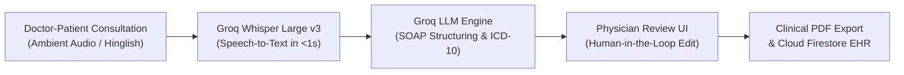
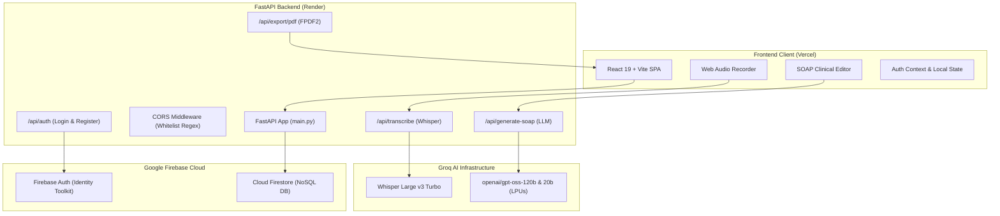

# Product Requirements Document (PRD)
## Project Name: VaidyaScribe (वैद्यScribe)
**Tagline:** AI-Powered Multilingual Clinical Documentation & Medical Scribe Copilot  
**Status:** Live in Production (`https://vaidyaascribe.vercel.app`)  
**Target Users:** Clinicians, Hospitals, Telemedicine Providers, Outpatient Clinics

---

## 1. Executive Summary

**VaidyaScribe** is an ambient AI medical scribe designed to solve clinical documentation burnout. It passively listens to doctor-patient consultations conducted in natural speech (including multilingual code-switching like Hinglish, mixed English/Hindi/regional dialects), transcribes the conversation with high medical fidelity using Groq-accelerated Whisper models, and autonomously structures the dialogue into standard **SOAP notes** (Subjective, Objective, Assessment with ICD-10, Plan).

The physician maintains 100% human-in-the-loop oversight through a real-time clinical editor, verifies the generated findings, and exports signed, professional PDF consultation summaries in one click.



---

## 2. Why Is This Project So Important? (The Real-World Problem)

### 2.1 The Clinical Documentation Crisis
- **"Pajama Time":** Studies by the *American Medical Association (AMA)* show that for every **1 hour** a physician spends with a patient, they spend **2 additional hours** on Electronic Health Record (EHR) typing and administrative paperwork.
- **Physician Burnout:** Over 63% of clinicians report burnout, with administrative typing cited as the #1 contributor.
- **Degraded Patient Connection:** Doctors are forced to stare at laptop screens typing during consultations instead of making eye contact, leading to reduced diagnostic empathy and patient trust.

### 2.2 The Multilingual & Code-Switching Gap
Existing medical dictation software (e.g., Dragon Medical) was built primarily for western English environments. In regions like India and Southeast Asia:
- Consultations are rarely pure English. A patient might say: *"Doctor sahab, do din se pet me bohot tez dard ho raha hai, ulti jaisa lag raha hai."*
- Doctors reply in a mix of clinical English and vernacular guidance.
- Generic tools fail completely when languages are mixed (**code-switching**).

### 2.3 What Happens Without VaidyaScribe vs. With VaidyaScribe?

| Dimension | Traditional Practice (Without VaidyaScribe) | With VaidyaScribe |
|---|---|---|
| **Documentation Time** | 6–10 minutes per patient after consultation | **Zero extra typing** (notes generated in < 2 seconds) |
| **Doctor Attention** | Focused on keyboard & screen | **100% focused on patient** |
| **Multilingual Handling** | Doctor must mentally translate & type | System transcribes code-switching and outputs standardized English SOAP |
| **Note Completeness** | Crucial patient details forgotten by end of shift | Objective verbatim record retained |
| **Discharge / Prescription** | Illegible handwritten prescriptions | **Clean, standardized clinical PDF** with generic drug names & instructions |

---

## 3. Real-Life Use Cases & Concrete Examples

### Example 1: High-Volume Outpatient (OPD) Clinic
- **Setting:** A general physician seeing 60–80 patients a day in an urban hospital.
- **Workflow:** 
  1. The doctor taps **"Record"** on their phone or tablet at the start of the consultation.
  2. The patient speaks in Hindi; the doctor conducts physical exam and gives oral instructions.
  3. By the time the patient stands up, VaidyaScribe has generated the complete SOAP note with ICD-10 codes.
  4. The doctor glances at the screen, clicks **"Verify & Commit"**, prints the PDF, and hands it to the patient.
  5. **Time saved:** ~5 hours of typing per 60 patients.

### Example 2: Telemedicine Consultations
- **Setting:** Video/Audio consultation platform where patients consult from remote towns.
- **Workflow:** The audio stream is captured and processed by VaidyaScribe, generating immediate electronic medical records stored in Cloud Firestore without requiring third-party human transcribers.

---

## 4. How We Built It (System Architecture & Technology Stack)



### 4.1 Frontend Layer
- **Framework:** React 19 with Vite 8.
- **Routing:** React Router v7 with protected clinician routes (`/dashboard`, `/new`, `/session/:id`, `/profile`).
- **Audio Capture:** HTML5 MediaStream Recording API producing compressed audio blobs (`webm`/`mp3`/`wav`).
- **Deployment:** Vercel Global Edge Network with custom `_redirects` and `vercel.json` rewrite rules for client-side routing.

### 4.2 Backend Layer
- **Framework:** FastAPI (Python 3.11) running on Uvicorn ASGI server with dynamic port binding.
- **Module Resolution:** Automatic `sys.path` injection preventing container import failures.
- **CORS Management:** Strict origin whitelisting (`https://vaidyaascribe.vercel.app` + localhost) with regex fallbacks for preview branches.
- **PDF Generation:** FPDF2 creating formatted clinical consultation summaries with institutional headers and signatures.
- **Deployment:** Render Cloud Web Service with zero-downtime container deploys.

### 4.3 AI & Intelligence Layer
- **Groq LPU (Language Processing Unit) Cloud:** Sub-second inference speeds eliminating physician wait times.
- **Speech-to-Text:** `whisper-large-v3-turbo` with prompt biasing for medical terminology and multilingual phonetic resilience.
- **Clinical Structuring Engine:** `openai/gpt-oss-120b` (primary) with resilient fallback to `openai/gpt-oss-20b` and `qwen/qwen3.8-27b`.
- **System Prompt Design:** Enforces strict adherence to SOAP standards, ICD-10 diagnostic classifications, generic drug name parenthesis mapping, and evidence-based plan recommendations.

### 4.4 Database & Security Layer
- **Authentication:** Firebase Authentication with JWT token verification.
- **Database:** Google Cloud Firestore collections:
  - `doctor_profiles`: Practitioner credentials, MCI/State medical registration numbers, clinic address.
  - `sessions`: Consultation transcript, Subjective, Objective, Assessment, Plan, duration, timestamp, patient reference.

---

## 5. The SOAP Note Structure Explained with an Example

VaidyaScribe organizes medical data according to the globally accepted medical standard:

### Real-Life Consultation Transcript:
> **Patient:** *"Doctor, I've had this terrible burning pain in my upper stomach for 4 days. It gets worse after eating spicy food, and I felt nauseous this morning."*  
> **Doctor:** *"Let me check. Any pain when I press here? Yes, tenderness in the epigastrium. Blood pressure is 120 over 80. You have gastritis, but we should rule out peptic ulcer. I am writing Pantoprazole 40 milligrams once daily before breakfast for 14 days. Avoid spicy and fried foods. Get an ultrasound if pain persists and see me in a week."*

### VaidyaScribe Structured Output:

```
SUBJECTIVE:
Patient presents with severe burning epigastric pain of 4 days duration. 
Symptoms exacerbate following spicy food consumption. Accompanied by nausea on presentation morning.

OBJECTIVE:
Vitals: BP 120/80 mmHg.
Physical Examination: Tenderness elicited on palpation in the epigastric region.

ASSESSMENT:
Primary: Acute Gastritis (ICD-10: K29.70).
Differential Diagnosis: Peptic Ulcer Disease (ICD-10: K27.9).

PLAN:
1. Medications:
   - Tab Pantoprazole 40mg (Generic: Pantoprazole Sodium) - 1 tablet orally once daily before breakfast x 14 days.
2. Dietary/Lifestyle Advice:
   - Avoid spicy, oily, and highly seasoned food. Eat small, frequent meals.
3. Investigations:
   - Abdominal Ultrasound (USG) if symptoms do not improve within 3-5 days.
4. Follow-up:
   - Review in clinic in 7 days or immediately if melena, hematemesis, or intractable pain occurs.
```

---

## 6. Important Interview & Defense Questions

### Q1: Why use Groq instead of direct OpenAI API?
> **Answer:** Latency and cost. Transcribing 5 minutes of audio and passing it to a standard LLM via conventional GPUs takes 8–15 seconds—unacceptable while a patient is sitting in front of the doctor. Groq runs on custom **LPUs (Language Processing Units)**, delivering completions at >400 tokens/second (~0.8 seconds total latency). This enables a true real-time ambient experience.

### Q2: How does VaidyaScribe prevent AI hallucinations in medical prescriptions?
> **Answer:** 
> 1. **Prompt Constraint:** The model is strictly instructed: *"Do not invent information not present in the transcript."*
> 2. **Human-in-the-Loop (HITL):** The generated SOAP note is treated as a **draft**. The clinician is provided with a live, editable interface to review, edit, or reject any recommendation before clicking *"Verify & Commit"*.
> 3. **Draft Disclaimers:** All exported PDFs carry an audit watermark: *"AI-assisted draft. Review and verify before use."*

### Q3: How is patient privacy and medical compliance addressed?
> **Answer:** 
> - Audio is processed ephemerally and discarded after transcription unless persistent storage is opted in by the clinic.
> - Access to Firestore sessions is scoped strictly to the authenticated `doctor_id`.
> - The patient reference uses anonymized identifiers (`patient_ref` e.g., `PAT-1029`) instead of storing government national IDs in plain text.

### Q4: How does it handle mixed languages (code-switching)?
> **Answer:** Groq Whisper is a cross-attention sequence-to-sequence model trained on 680,000+ hours of multilingual data. It understands phonetic patterns across English, Hindi, and regional dialects simultaneously. The downstream LLM prompt instructs the model to translate colloquial descriptions into standard international clinical terminology (e.g. converting *"chhati me jalan"* to *"retrosternal pyrosis / gastroesophageal reflux"*).

---

## 7. Future Roadmap

1. **ABDM (Ayushman Bharat Digital Mission) Integration:** Connecting with India's national health stack via FHIR/M1/M2/M3 APIs for automated health record exchange.
2. **Drug-Drug Interaction (DDI) Engine:** Real-time safety alerts if a newly prescribed drug clashes with patient allergy or existing medication.
3. **Automated WhatsApp Patient Instructions:** Generating patient-friendly vernacular summary cards (e.g. Hindi/Tamil/Bengali instructions on when to take tablets) sent directly to the patient's phone.
